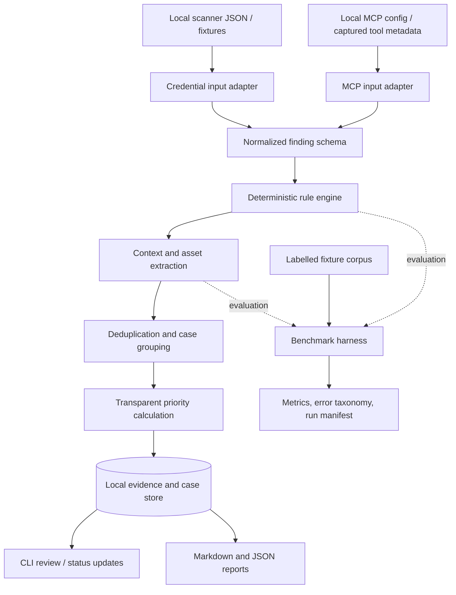

# Exposure Triage Workbench

**Product specification and build scope**  
**Version:** 0.1 — MVP specification  
**Status:** Proposed; ready for implementation planning  
**Primary use case:** Security-consulting and threat-intelligence triage  
**Working name:** *Exposure Triage Workbench* (ETW). Check repository/package/trademark availability before making the name permanent.

---

## 1. Executive summary

Exposure Triage Workbench (ETW) is a local-first tool that converts noisy security findings into **reviewable, evidence-backed cases**. It will support two finding families through a shared case-management and reporting pipeline:

1. **Credential exposure triage — the primary workflow.** Import findings from existing secret detectors, classify known placeholders/test/canary patterns, deduplicate results, link nearby asset evidence, document confidence and potential business impact, and produce a redacted investigation report.
2. **MCP configuration and exposure triage — the secondary workflow.** Inspect supported local MCP configuration files and captured tool metadata for risky configuration indicators, map each result to the same case schema, explain why it was flagged, and recommend a safe review action.

The product is **not a replacement for secret scanners, a full attack-surface management platform, or a general-purpose MCP exploit scanner**. Existing tools remain responsible for discovery. ETW focuses on the work after a candidate is detected: normalization, contextual triage, evidence preservation, prioritization, and consultant-ready output.

### Core product hypothesis

A shared evidence and case workflow can help a security analyst review findings more consistently than reviewing raw scanner output alone. ETW must test this hypothesis with a reproducible labelled corpus and a small, documented MCP configuration benchmark. The project must not claim improved accuracy or reduced analyst time until those results are measured.

### Recommended scope decision

Build both finding modules, but do **not** build two full scanners. The credential module gets the majority of implementation time. The MCP module is a bounded static configuration and metadata analyser in the MVP; remote probing, exploitation, internet-wide discovery, and dynamic attack testing are explicitly excluded.

---

## 2. Problem statement

Security platforms and open-source tools can identify possible exposed credentials or risky MCP configurations. However, a raw detection is not the same as a validated security issue. Analysts still need to answer:

- Is this a meaningful finding, an example value, a known test key, a canary, a duplicate, or an uncertain signal?
- What asset or configuration is associated with it?
- What evidence supports the conclusion?
- What is known, what is inferred, and what remains unverified?
- How should the finding be prioritized and communicated to an engineer, customer, or CISO?

ETW addresses this workflow with transparent rules, an explicit uncertainty model, evidence references, a consistent case schema, and reproducible reports.

**Important distinction:** Public product pages and the internship description establish that CloudSEK works in exposure discovery, credential intelligence, MCP/AI attack-surface monitoring, triage, validation, and reporting. They do not prove that CloudSEK lacks internal tooling for these tasks. ETW is a portfolio project demonstrating a relevant workflow, not a claim that it fills a confirmed internal CloudSEK product gap.

---

## 3. Product goals and non-goals

### 3.1 Goals

- Provide one normalized case model for credential-related and MCP-related findings.
- Reduce duplicate review work through deterministic normalization and deduplication.
- Explain each classification and priority with evidence and rule identifiers.
- Preserve provenance without persisting raw credential values in the case database or reports.
- Correlate findings with nearby repository, endpoint, resource, or configuration context.
- Produce reproducible JSON and Markdown outputs suitable for a security consultant's workflow.
- Measure detection/triage quality on labelled and synthetic fixtures, including false dismissals.
- Run locally with a minimal, low-cost stack.

### 3.2 Non-goals

ETW will not, in the MVP:

- Replace Gitleaks, TruffleHog, CloudSEK, or any commercial detection platform.
- Crawl the public internet, dark web, paste sites, or underground forums.
- Search arbitrary third-party repositories or assets without an explicit scope.
- Attempt to log in with discovered credentials, enumerate privileges, or call authenticated vendor APIs using third-party secrets.
- Exploit remote MCP servers, attempt command injection/SSRF/RCE, or send fuzzing payloads to production systems.
- Assert that an MCP server is exploitable merely because a configuration has a risky indicator.
- Use an LLM to make final security classifications or invent evidence.
- Claim production readiness, customer adoption, CloudSEK endorsement, or benchmark improvements before they are demonstrated.
- Build an enterprise multi-tenant SaaS platform, billing, a SIEM, a graph database, or a complex dashboard in the MVP.

---

## 4. Target users and jobs to be done

### Primary user: Security consultant / threat-intelligence analyst

**Job:** Review incoming exposure findings, determine what deserves attention, assemble defensible evidence, and communicate an actionable next step.

### Secondary user: Application-security engineer

**Job:** Review secret-detector output or local MCP configuration before a release or during an authorized assessment.

### Portfolio evaluator: Security hiring manager

**Job:** Verify that the developer understands evidence quality, safe handling of sensitive findings, engineering discipline, reproducibility, and business-facing security communication.

---

## 5. User journeys

### Journey A — Credential finding triage

1. The user imports JSON output from a supported detector or a supplied fixture set.
2. ETW parses the output, normalizes fields, and computes a keyed fingerprint for deduplication.
3. ETW evaluates deterministic context rules for examples, placeholders, known test patterns, canary indicators, low-information values, and source context.
4. ETW extracts associated evidence such as repository, file path, commit, hostnames, URLs, package names, cloud-resource references, and nearby deployment markers.
5. ETW assigns a transparent triage category and provisional priority. Uncertainty is retained; no result is silently discarded.
6. The analyst reviews cases, changes status, adds a note, and records the rationale.
7. ETW emits a redacted Markdown report and a machine-readable JSON case bundle.

### Journey B — MCP configuration triage

1. The user imports a supported local MCP configuration file or a captured JSON document describing an MCP server and its tools.
2. ETW parses the server definition without executing the configured command or starting the server.
3. Static rules inspect transport URLs, explicit configuration fields, command/argument patterns, environment-variable references, secret-like literal values, package/version references, and captured tool names/descriptions.
4. ETW creates findings that distinguish **observed configuration facts** from **potential risks requiring validation**.
5. Each finding includes a rule ID, evidence location, rationale, confidence, limitations, and a safe next step.
6. Findings enter the same case list and reporting pipeline as credential findings.

### Journey C — Report and benchmark

1. The user runs the same fixture corpus through a baseline detector/export and ETW.
2. The benchmark harness compares labels against ETW classifications and records false positives, false negatives, incorrect dismissals, and unresolved cases.
3. A report is generated with tool versions, dataset version, configuration hash, evaluation date, metrics, and caveats.

---

## 6. Scope by release

### 6.1 MVP — mandatory scope

| ID | Feature | Exact MVP behaviour | Acceptance criterion |
|---|---|---|---|
| F-001 | Local-first CLI | All primary actions are available from a CLI; no account or cloud service required. | Fresh install can run the sample workflow using documented commands. |
| F-002 | Credential input adapter | Accept local JSON output from at least one of Gitleaks or TruffleHog, plus ETW's own fixture schema. | Valid fixtures parse; malformed records produce useful errors without crashing the entire run. |
| F-003 | Normalized case schema | Convert input records into a stable ETW finding/case format. | Unit tests cover required fields, missing optional fields, and unsupported record versions. |
| F-004 | Deduplication | Deduplicate the same candidate across repeated detector outputs using a keyed fingerprint and source context. | Duplicate fixtures map to one primary case with all source references retained. |
| F-005 | Secret-safe storage | Raw secret values are processed in memory only and are not written to the case database, logs, test snapshots, or generated reports. | Automated tests assert raw fixture secrets do not appear in persisted files or reports. |
| F-006 | Deterministic credential triage | Identify known examples/placeholders/test values and canary indicators; use entropy/context only as supporting signals. | Each classification includes a rule ID, reason, confidence, and evidence reference. |
| F-007 | MCP config adapter | Parse ETW's documented MCP JSON schema and one common `mcpServers`-style JSON structure. Do not execute commands. | Valid examples from both formats parse; invalid structures fail safely. |
| F-008 | MCP static rules | Evaluate configured transport, command, args, env references, literal secret exposure, and captured tool metadata for defined indicators. | Every rule has a unit test, severity rationale, and known limitations documented. |
| F-009 | Shared case lifecycle | Support `new`, `needs_review`, `confirmed`, `false_positive`, `unresolved`, `accepted_risk`, and `remediated`. | Status transitions and analyst notes persist and appear in exports. |
| F-010 | Asset/context extraction | Extract nearby hostnames, URLs, package names, cloud-resource strings, file paths, and deployment keywords from supplied evidence. | Tests validate extraction and ensure unrelated text does not become a confirmed asset link. |
| F-011 | Explainable priority | Compute a provisional priority from transparent factors; retain the factor breakdown. | A report displays each score contribution and labels the result as triage support, not definitive risk. |
| F-012 | Report output | Generate Markdown case reports and normalized JSON export with redacted evidence and source provenance. | Sample report is generated end-to-end from fixtures and every claim links to evidence or a stated inference. |
| F-013 | Benchmark harness | Run labelled credential fixtures and MCP configuration fixtures; produce machine-readable metrics. | Same pinned inputs and code version reproduce the same result set, except documented nondeterministic metadata. |
| F-014 | Security and regression tests | Include tests for secret leakage, malformed input, duplicate cases, report redaction, and parser edge cases. | CI passes; secret scan runs against ETW's own repository. |
| F-015 | Documentation | README quickstart, architecture, rule catalog, threat model, data handling, benchmark method, limitations, and demo steps. | Another developer can reproduce the demo following the docs without undocumented setup. |

### 6.2 Stretch scope — only after the MVP is stable

- Optional FastAPI read-only interface to list and retrieve cases.
- Minimal web interface for filtering and reviewing cases.
- One additional scanner format adapter.
- SARIF export for findings where the schema maps cleanly.
- Git-history exposure age analysis for local, authorized repositories.
- MCP tool-list import from a controlled lab server, where the data is captured by the operator.
- PDF report output.
- Optional policy-gated live verification for credentials explicitly owned by the operator, only after a separate authorization model, safe endpoint policy, audit log, and threat review are implemented. This is **not** part of the MVP.

### 6.3 Explicitly out of scope for the first 8 weeks

- Internet-wide asset discovery or scanning.
- Dark-web/infostealer acquisition or monitoring.
- Remote MCP probing, exploitation, fuzzing, or payload injection.
- Credential login attempts or privilege enumeration against third-party systems.
- APK decompilation and large-scale mobile app ingestion.
- Automated remediation, token rotation, takedowns, or ticket creation in customer systems.
- Autonomous AI agents making or executing security decisions.
- Claims that a secret is live based on syntax alone.
- Claims that a remote MCP endpoint is unauthenticated without an authorized, valid check.
- Multi-tenant SaaS, complex permissions management, distributed processing, or enterprise deployment.

---

## 7. Functional specification: credential module

### 7.1 Inputs

- Supported detector JSON exported to a local file.
- Local repository or fixture bundle only if an explicit `scan-local` adapter is later enabled; the MVP can operate exclusively on detector output.
- Synthetic test fixtures generated specifically for ETW.

### 7.2 Classification states

ETW uses **triage classifications**, not absolute truth claims:

- `likely_placeholder`: strong match for documentation or example patterns.
- `likely_test_value`: matches a known test fixture or test-key pattern.
- `likely_canary`: matches a documented canary format; do not interact with it.
- `candidate_secret`: detector/context supports a secret-like value but live status is unverified.
- `needs_review`: conflicting, incomplete, or low-confidence signals.
- `excluded_by_policy`: excluded by an explicit user-supplied rule; remains in audit output.

The MVP does **not** produce `confirmed_live` from a remote authentication call. If imported detector output already reports a verification status, that status is stored as source-reported metadata and clearly attributed to the source tool; ETW does not imply it independently verified the credential.

### 7.3 Deterministic rules

- Known provider documentation examples and placeholder patterns.
- Known public test-key patterns where usage permits.
- Canary-token indicators from documented formats.
- Context keywords such as `example`, `sample`, `replace_me`, `changeme`, `dummy`, and equivalent fixture markers.
- High/low entropy as a weak supporting signal only.
- File context such as documentation, example, fixture, test, sample, or production configuration.
- Duplicate findings across detectors and commits.

Rules must not silently delete findings. They set classification and confidence; the case remains reviewable and exported unless the user explicitly filters it.

### 7.4 Correlation

For each candidate, extract and relate only evidence available in the supplied input:

- Repository/project identifier, file path, commit, line number, detector, and first/last observed times if provided.
- Hostnames, URLs, package names, cloud resource identifiers, and references found in the same file or bounded context window.
- Environment markers such as `dev`, `test`, `staging`, `prod`, `backup`, `billing`, and `customer`; these are hints, not proof of data sensitivity.

Each relationship records `observed`, `derived`, or `human_confirmed`. ETW must not convert a co-located endpoint or a name like `production-db` into a claim that the credential grants access to that resource.

### 7.5 Required output fields

At minimum: case ID, finding type, triage classification, priority, confidence, source tool, source location, keyed secret fingerprint, redacted context, rule IDs, associated asset candidates, evidence references, provenance, analyst status, notes, limitations, and recommended next action.

---

## 8. Functional specification: MCP module

### 8.1 Purpose and guardrail

The MCP module is a **configuration and captured-metadata triage analyser**, not a remote vulnerability scanner. MCP is relevant because CloudSEK publicly describes AIVigil as monitoring exposed AI infrastructure and MCP servers. The official MCP documentation also highlights security considerations around token audience validation, token storage, authorization, URL schemes, and server/client behavior. These are appropriate sources for review rules; the rules must not imply that configuration inspection alone proves runtime exploitability.

### 8.2 Accepted inputs

- ETW's canonical MCP JSON document.
- One supported `mcpServers`-style JSON configuration structure with `command`, `args`, `env`, or a remote `url` field.
- Optional captured JSON tool metadata exported by an operator from a local test server.

ETW will not execute `command`, load extensions, spawn an MCP server, call configured tool endpoints, or read environment values from the user's machine. It parses only the file contents provided to it.

### 8.3 Initial rule catalog

Rule IDs are stable API/documentation identifiers. Findings are indicators that require contextual review, not automatically confirmed vulnerabilities.

| Rule ID | Name | Trigger | Default severity | Required explanation / limitation |
|---|---|---|---|---|
| MCP-CFG-001 | Remote HTTP transport | Remote MCP URL uses HTTP rather than HTTPS. | High | Flag plaintext transport; do not apply the same rule to loopback/local development without context. |
| MCP-CFG-002 | Authentication posture unknown | A remote endpoint is configured but the supplied configuration contains no evidence of authentication policy. | Medium | Say “not verified from supplied config”; never claim it is unauthenticated. |
| MCP-CFG-003 | Literal secret in configuration | A value appears to embed a token, key, password, or credential directly in a config string. | High | Redact value; never attempt to use it; false positives are possible. |
| MCP-CFG-004 | Sensitive environment variable reference | Config maps likely sensitive variable names or values into a server process. | Medium | Report variable names and presence only; do not read actual process environment or print literal values. |
| MCP-CFG-005 | Execution-capable local server | Server starts through an interpreter, shell, package runner, or executable with broad capabilities. | Informational/Medium | This is an attack-surface indicator, not a vulnerability by itself; review publisher, pinning, arguments, and isolation. |
| MCP-CFG-006 | Unpinned package reference | Package reference uses a floating tag or lacks a clear version/commit pin where the format supports it. | Medium | Only report if detectable from supplied config; no package reputation claim is made. |
| MCP-CFG-007 | Risk-sensitive tool capability | Captured tool name/description indicates filesystem write/delete, shell/command execution, arbitrary SQL, or broad administrative actions. | Medium/High | Flag capability and explain why it needs least-privilege review; descriptions can be misleading or incomplete. |
| MCP-CFG-008 | Tool metadata unavailable | A server entry has no captured tool inventory. | Informational | A visibility gap, not a vulnerability. |
| MCP-CFG-009 | Insecure URL scheme | A supplied URL uses a dangerous or unexpected scheme in a field meant to be an HTTP(S) endpoint. | High | Validate only the parsed configuration value; do not open or fetch it. |
| MCP-CFG-010 | Duplicate server definition | Equivalent server entries appear multiple times across imported configurations. | Low | Correlate definitions but do not assume they are the same deployment without matching evidence. |

Severity is a default triage label. Each rule must include confidence, evidence location, affected configuration entry, limitations, and a recommended review step.

### 8.4 MCP features in the MVP

- Parse and validate the supported configuration formats.
- Identify the server name, transport/type, command, arguments, environment variable **names**, remote URL, and captured tool metadata fields that are actually present.
- Run the initial rule catalog above.
- Redact potential credentials before any output or persistence.
- Generate cases using the shared schema.
- Explain why every rule fired and what it cannot determine.
- Provide an example safe remediation checklist, such as use HTTPS for remote endpoints, review authentication, pin packages, minimize capabilities, protect secrets, and isolate local execution.

### 8.5 MCP features not in the MVP

- Dynamic protocol fuzzing or malicious tool invocation.
- Attempts to demonstrate prompt injection, command injection, SSRF, path traversal, RCE, token theft, or data exfiltration against a remote server.
- Automatic network requests to test authentication or transport behavior.
- Declaring an endpoint vulnerable based solely on its banner, URL, tool name, or server description.
- Scanning the public internet for MCP servers.

---

## 9. Shared case model and prioritization

### 9.1 Core data entities

- **Case:** analyst-facing unit of work.
- **Finding:** one rule or source observation supporting the case.
- **Evidence artifact:** redacted, location-linked item supporting a statement.
- **Asset candidate:** hostname, URL, package, cloud resource reference, repository, server configuration, or other typed identifier.
- **Relationship:** an evidence-backed link between case and asset candidate, labelled by confidence/source.
- **Rule:** versioned deterministic evaluation with severity rationale and limitations.
- **Run manifest:** ETW version, source tool versions, input dataset hash, config hash, timestamp, and ruleset version.

### 9.2 Triage priority

Use a transparent 0–100 **review-priority score**, not a vulnerability score and not a claim of exploitability.

| Factor | Weight | Interpretation |
|---|---:|---|
| Evidence strength | 30 | Direct, repeatable evidence scores higher than weak string matches. |
| Exposure/context | 20 | Publicly exposed location or a specific remote transport scores above an unknown context, if supported by input evidence. |
| Potential impact indicators | 20 | Sensitive resource/deployment indicators; they remain inferred until confirmed. |
| Confidence in classification | 15 | Strength and agreement of the evidence supporting the label. |
| Recency/source provenance | 10 | Timestamped, traceable and recent evidence scores higher than stale/unknown evidence. |
| Uncertainty/contradictions | 5 | Contradictory or incomplete evidence is surfaced and prevents overconfident ranking. |

For the uncertainty factor, the implementation may subtract up to 5 points from the raw score or expose it as a separate penalty; the exact method must be fixed in code and documented. The same inputs must yield the same score. The report must show the factor breakdown.

Priority labels: `P1 urgent review` (80–100), `P2 high review` (60–79), `P3 normal review` (35–59), `P4 low review` (0–34). These labels determine review order only. They are not CVSS ratings and cannot substitute for analyst judgement.

### 9.3 Analyst statuses

`new` → `needs_review` → one of `confirmed`, `false_positive`, `unresolved`, `accepted_risk`, or `remediated`.

Status transitions and analyst decisions must be stored with timestamp and optional rationale. A later rule rerun must not silently overwrite an analyst's decision; it should record a new evaluation and preserve history.

---

## 10. Architecture



### Design choices

- **Python 3.12+** for parsing, rules, CLI and tests.
- **Typer** for CLI ergonomics.
- **Pydantic** for input validation and normalized data models.
- **SQLite** for local case metadata and event history.
- **Jinja2** for Markdown report templates.
- **pytest** for unit/integration tests.
- **Gitleaks and/or TruffleHog** as optional source detector adapters; pin tested versions and respect their licenses/terms.
- **Docker** only for reproducible development/benchmark environments, not as a claim that dynamic target testing is included.

Do not add a vector database, message broker, cloud deployment, Kubernetes, or an LLM dependency to the MVP. These add complexity without being necessary for the target workflow.

---

## 11. CLI interface contract

The exact command names can change during implementation, but the MVP should support these operations:

```bash
# Parse and normalize detector JSON
etw ingest secrets --input samples/gitleaks.json --out runs/demo/

# Analyse a local MCP configuration without executing it
etw analyze mcp-config --input samples/mcp-config.json --out runs/mcp-demo/

# Review and update cases
etw cases list --status needs_review
etw cases show CASE-0001
etw cases set-status CASE-0001 confirmed --note "Confirmed from authorized lab evidence"

# Export evidence-backed reports
etw report markdown --run runs/demo/ --out reports/demo.md
etw export json --run runs/demo/ --out reports/demo.json

# Reproduce a benchmark
etw benchmark run --dataset datasets/fixtures-v1 --out benchmark/results/
```

All example data must be synthetic, sanitized, or explicitly authorized. A command that accepts a local config file must parse it as data only; it must never execute the commands embedded in that file.

---

## 12. Security, privacy, and safe-use requirements

These requirements are mandatory, not optional enhancements.

1. **No raw secret persistence.** Secret values must not be written to database rows, logs, reports, screenshots, test snapshots, or telemetry. Process values in memory, compute a keyed HMAC fingerprint for deduplication, and persist only redacted evidence and metadata.
2. **Local-first.** No telemetry or remote upload by default. Dependencies and optional APIs must be documented.
3. **No unauthorized live checks.** The MVP does not authenticate with discovered credentials, test their privileges, or submit them to third-party APIs.
4. **No target execution.** MCP configuration commands are parsed, never run.
5. **Explicit scope.** Any optional repository scan must require an explicit local path or organization scope and must respect source terms and permissions.
6. **Redaction tests.** Every output type is tested with seeded secrets to ensure raw values do not survive in persisted data.
7. **Evidence provenance.** Reports record source tool, source location, ruleset version, run manifest and dataset hash.
8. **Human review.** Automated classification is advisory. Low-confidence, contradictory, or unsupported evidence becomes `needs_review` or `unresolved`.
9. **No harmful PoCs.** Demo fixtures must not contain functional third-party credentials, exploit payloads, or real customer data.
10. **Responsible disclosure.** Any finding outside a controlled lab requires authorization and established disclosure procedures; the product does not automate disclosure submission.

---

## 13. Data strategy and evaluation

### 13.1 Data sources

- Synthetic, fully labelled credential fixtures created for ETW, including placeholders, repeated detections, test values, canary-like examples, redacted real-world-shaped samples, and edge cases.
- Detector documentation and public test fixtures, subject to each project's license and safe-use policy.
- A publicly available labelled academic secret benchmark only after reviewing its license, data-protection requirements, and permitted use. Do not redistribute restricted datasets or real credentials.
- Synthetic MCP configuration files covering each rule, plus manually reviewed safe configuration examples.
- MCP security requirements from the official MCP specification and security best-practice documents.

### 13.2 Metrics

For credential triage:

- Precision and recall for the defined labelled fixture dataset.
- False-positive and false-negative counts.
- Incorrect-dismissal rate: true positives wrongly classed as placeholders/test/canary/excluded.
- Duplicate reduction, with a review of accidental merges.
- Redaction-test pass rate.
- Evidence completeness: proportion of report claims linked to evidence or explicitly marked inference.

For MCP configuration triage:

- Rule-level true/false positives on the labelled configuration corpus.
- Rule coverage: proportion of defined rule cases represented in test fixtures.
- Incorrect confidence/severity count after manual adjudication.
- Parse success rate for supported valid inputs and safe failure rate for malformed inputs.

For analyst usefulness:

- Time to triage a fixed set of cases before and after ETW, measured by the developer using the same protocol.
- Number of manual steps eliminated or consolidated.
- Reviewer feedback from a small, clearly described sample, if available.

### 13.3 Evaluation rules

- Record the baseline before implementing classification rules.
- Freeze dataset versions and publish the dataset-generation method.
- Publish failures as well as successes.
- Never assert a desired threshold as a result before measurement.
- Do not generalize synthetic-corpus results to all production environments, dark-web sources, or CloudSEK's proprietary data.
- Keep manually labelled evaluation data separate from rule development where practical to reduce overfitting.

### MVP success targets

These are release acceptance targets, not promises of achieved performance:

- 100% of output/report fields containing security claims link to evidence or are explicitly labelled inference.
- 0 raw secret values persisted in the automated redaction test suite.
- 100% of listed MVP rules have at least one positive and one negative fixture.
- Reproducible benchmark command and published confusion matrix for each evaluated module.
- No unresolved critical test failures in parser, redaction, or case identity handling.
- At least one end-to-end credential case and one end-to-end MCP configuration case demonstrated from input to report.

Do not set a minimum false-positive-reduction claim as a release requirement. If no improvement is measured, document that honestly and revise or narrow the rules.

---

## 14. Implementation plan

| Week | Focus | Deliverable | Exit criteria |
|---|---|---|---|
| 1 | Validate existing tools and schemas; create repo and threat model | RFC, sample corpus, schema draft, baseline measurements | Inputs/outputs and safe data-handling policy are fixed; existing-tool overlap documented. |
| 2 | Core schema, ingestion, deduplication, local storage | Credential JSON adapter and case store | Unit tests pass; repeated findings group correctly; raw secret redaction tests pass. |
| 3 | Credential rules and context extraction | Classification/rule engine, asset candidates, rule explanations | Each rule has positive/negative fixtures; uncertainty remains explicit. |
| 4 | MCP parser and static rules | Supported config adapters and initial MCP rule catalog | Configs are never executed; each rule has tests and limitation notes. |
| 5 | Shared prioritization, case lifecycle, reporting | CLI, Markdown/JSON report, status updates | Full demo runs end-to-end across both modules. |
| 6 | Benchmark harness and error analysis | Metrics output, baseline comparison, known-failure taxonomy | Results regenerate from versioned fixtures; claims match measured results. |
| 7 | Hardening and optional API/UI | Regression tests, typed errors, improved docs; optional FastAPI only if core is stable | Core workflows remain reliable; no scope creep threatens evaluation. |
| 8 | Portfolio packaging | Architecture diagram, demo recording, release, resume bullet based on real metrics | Clean install and reproducible demo; limitations and benchmark are transparent. |

### Go/no-go checks

- **End of week 1:** if input data/license constraints block valid evaluation, use synthetic fixtures and document the limitation.
- **End of week 3:** if classifier rules do not improve the baseline or increase false dismissals, reduce the rules rather than overfit to a headline metric.
- **End of week 4:** if MCP support threatens the credential pipeline, cut MCP to its parser plus a smaller set of high-value static rules. Do not sacrifice the shared evidence engine to reach feature-count goals.
- **End of week 6:** if metrics are weak, publish the negative result and identify failure modes; do not manufacture performance claims.

---

## 15. Repository structure

```text
exposure-triage-workbench/
├── README.md
├── LICENSE
├── pyproject.toml
├── docs/
│   ├── PRODUCT.md
│   ├── ARCHITECTURE.md
│   ├── THREAT_MODEL.md
│   ├── DATA_HANDLING.md
│   ├── RULE_CATALOG.md
│   └── BENCHMARK_METHOD.md
├── src/etw/
│   ├── cli.py
│   ├── models/
│   │   ├── finding.py
│   │   ├── case.py
│   │   └── evidence.py
│   ├── ingest/
│   │   ├── gitleaks.py
│   │   ├── trufflehog.py
│   │   └── mcp_config.py
│   ├── rules/
│   │   ├── secrets.py
│   │   └── mcp.py
│   ├── analysis/
│   │   ├── context.py
│   │   ├── correlate.py
│   │   └── prioritize.py
│   ├── storage/
│   │   ├── database.py
│   │   └── redaction.py
│   ├── reports/
│   │   ├── markdown.py
│   │   └── json_export.py
│   └── benchmark/
│       ├── runner.py
│       └── metrics.py
├── datasets/
│   ├── fixtures-v1/
│   └── README.md
├── samples/
│   ├── gitleaks.json
│   ├── trufflehog.json
│   └── mcp-config.json
├── tests/
│   ├── unit/
│   ├── integration/
│   ├── security/
│   └── fixtures/
├── benchmark/
│   ├── baseline.md
│   └── results/
└── reports/
    └── sample-case.md
```

Only include directories that contain implemented functionality. Do not leave empty modules that imply unimplemented features are supported.

---

## 16. Demo acceptance script

The final demo should take 4–6 minutes and use only synthetic or authorized fixtures.

1. Import a detector JSON file containing duplicates, a placeholder, a canary-like fixture, and candidate secrets.
2. Show the normalized cases and the reason each was classified.
3. Show how a candidate is linked to co-located asset evidence without claiming the linked resource was accessed.
4. Import a local MCP config containing a remote HTTP URL, a sensitive environment variable reference, and a tool with a high-impact capability description.
5. Show the MCP findings, their limitations, and recommended review steps.
6. Generate a unified Markdown/JSON report.
7. Run the benchmark and open the confusion matrix and known failure modes.
8. Demonstrate that seeded raw secrets are absent from reports, logs, and the persisted case store.

The demo must not use any real leaked credentials or scan a third-party target.

---

## 17. Portfolio and resume deliverables

Release evidence should include:

- A clear README explaining the problem, scope, supported inputs, quickstart, architecture, and limitations.
- A rule catalog with identifiers, severity rationale, example inputs, expected output, and known false positives.
- A threat model and a data-handling policy.
- A labelled fixture corpus or reproducible generator that contains no real secrets.
- Baseline and post-triage benchmark output, including false negatives and incorrect dismissals.
- Sample redacted reports for one credential finding and one MCP configuration finding.
- Test results and a clean-install reproduction procedure.
- A short demo video and architecture diagram.

### Resume bullet template — use only after metrics are real

> Built a local-first Python security triage workbench that normalizes and deduplicates secret-scanner findings, correlates evidence with likely affected assets, and statically assesses MCP configurations; evaluated credential and MCP rules on labelled fixtures, achieving **[measured metric]** while retaining evidence provenance and redacting raw secrets from persisted outputs.

Replace bracketed values only with measurements generated by the committed benchmark. If the measured result is qualitative rather than quantitative, omit the number.

---

## 18. Risks and mitigations

| Risk | Mitigation |
|---|---|
| Project becomes two unrelated products | Keep one schema, rule engine, case lifecycle, priority model, evidence store and report pipeline. MCP is an input adapter, not a second platform. |
| Scope exceeds 8 weeks | Prioritize credential ingestion/classification and shared reporting; cap MCP at static configuration and metadata analysis. |
| Existing tools already cover parts of the workflow | Integrate their output; differentiate through evidence quality, correlation, review workflow and measurable evaluation, not detection breadth. |
| Classification rules dismiss real secrets | Keep a `needs_review` path, measure incorrect dismissals, and never silently discard findings. |
| Secret leakage from logs/reports | In-memory processing, keyed fingerprints, central redaction, secret-leak regression tests, no telemetry. |
| MCP static result is mistaken for a confirmed vulnerability | Label it as a configuration indicator, state what cannot be verified, and require analyst validation. |
| Benchmarks contain sensitive material or have restrictive terms | Read licenses and data-use terms first; default to synthetic data; do not redistribute restricted datasets. |
| Unsupported claim about CloudSEK internals | Describe the project as aligned with publicly stated tasks; do not claim CloudSEK lacks similar tooling. |
| Name collision | Treat the name as provisional; check repository, package registry and trademark availability before public release. |

---

## 19. Research references

These sources justify the problem context and MCP review principles. They do not prove any internal CloudSEK workflow gap.

1. CloudSEK Security Consultant Intern listing: <https://job-boards.greenhouse.io/cloudsek/jobs/6115382004>
2. CloudSEK AIVigil product page: <https://www.cloudsek.com/aivigil>
3. CloudSEK AIVigil knowledge-base article: <https://www.cloudsek.com/knowledge-base/aivigil-for-ai-infrastructure>
4. Official MCP authorization security considerations: <https://github.com/modelcontextprotocol/modelcontextprotocol/blob/main/docs/specification/2026-07-28/basic/authorization/security-considerations.mdx>
5. Official MCP security best practices: <https://github.com/modelcontextprotocol/modelcontextprotocol/blob/main/docs/docs/2026-07-28/tutorials/security/security_best_practices.mdx>
6. TruffleHog documentation (supported sources and JSON output): <https://github.com/trufflesecurity/trufflehog/blob/main/docs/man/trufflehog.1>
7. Cisco AI Defense MCP Scanner: <https://github.com/cisco-ai-defense/mcp-scanner>

**Accessed:** 10 October 2026. Recheck product documentation, job status, supported schemas, and dataset terms before implementation because these may change.

---

## 20. Final product decision

**Decision: proceed with a unified exposure triage workbench, subject to strict scope control.**

The shared product is credible because credential findings and MCP configuration findings can share the same case schema, evidence model, provenance, prioritization, review lifecycle, reporting, and benchmark infrastructure. They should not share inaccurate detection logic: each module needs its own versioned rules and test fixtures.

The MVP's defining value is not the number of scanners it contains. It is whether it can turn a noisy input into a clear, appropriately cautious, traceable case that a security analyst can review and act on. The credential workflow is the primary proof of value; the MCP configuration workflow extends the same framework into an AI-security domain without attempting to compete with full external discovery platforms.

**Build order:** shared schema and safe handling → credential triage → MCP static configuration triage → unified reports → benchmark and demo. If time becomes constrained, reduce MCP rules rather than weaken the evidence pipeline or evaluation.
